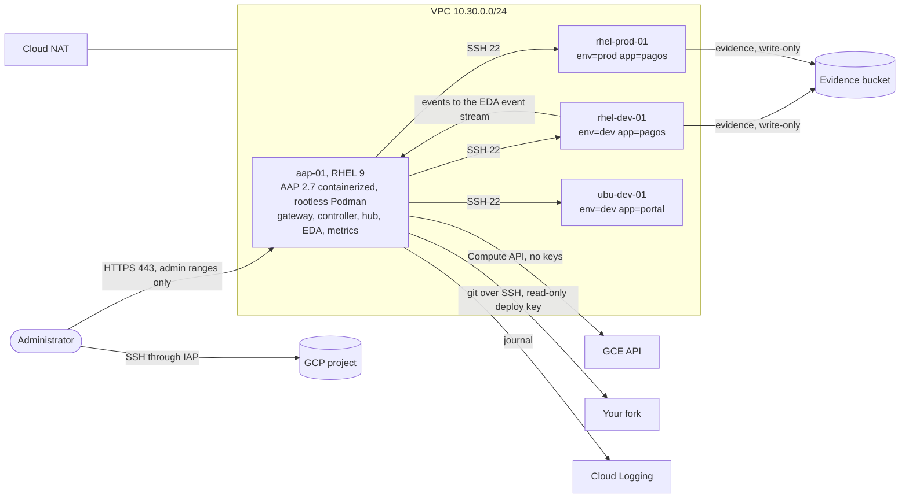

# Ansible Automation Platform 2.7 laboratory on Google Cloud

A laboratory for **Red Hat Ansible Automation Platform (AAP) 2.7**, containerized
installer on RHEL 9, built to answer the questions anyone adopting it at scale
should answer first: where credentials live, who can do what, how a change reaches
production, how compliance is evidenced, and how any of it is audited.

Everything is code: the Google Cloud project, the network and the VMs
(Terraform), the installation, a custom execution environment, the whole AAP
configuration (organization, teams, credentials, inventories, templates,
workflows, RBAC and Event-Driven Ansible), and one verification playbook per use
case that exercises it end to end against the running platform.



## What this is, and what it is not

**It is** a single-VM laboratory (the installer's *growth* topology) with three
managed nodes, built to be stood up by someone else, exercised, and destroyed.
Seven use cases are implemented and each has a verification playbook:

| # | Use case | What the verification proves |
|---|---|---|
| 1 | GCP dynamic inventory without keys | Hosts and groups come from labels; a stopped VM disappears on the next sync |
| 2 | CIS hardening with evidence | OpenSCAP before and after, score improves, reports land in a bucket, hardening is idempotent, no lockout |
| 3 | Patching dev → approval → prod | The launcher cannot approve; Security approves; a failure rolls back and never reaches production; a rollback with nothing new undoes nothing |
| 4 | RBAC by team | Each user can do exactly what the team allows, checked by content, not only by HTTP status |
| 5 | Custom execution environment | Built with ansible-builder, published to the private hub, no token left in the image |
| 6 | Event-Driven Ansible remediation | A stopped service is restarted with no human involved, by a service user allowed to do nothing else |
| 7 | Traceability | A read-only auditor exports who launched and who approved what; platform logs reach Cloud Logging |

**It is not** a production design. One VM, no high availability, a self-signed
certificate, the UI on a public IP restricted to admin ranges, demo users with
local passwords, and the evidence bucket can be destroyed with the lab. What a
production topology needs is listed at the end.

**It was verified** on 2026-11-02 against a real project and a 60-day AAP trial,
then destroyed. For publication, environment identifiers were replaced by
parameters and the inventory was renamed to `gcp-lab`; nothing else changed.
Object names (`Operaciones`, `Seguridad`, `Auditoria`, `parcheo-controlado`,
`remediar-servicio`, …) are kept as they were verified.

## Layout

| Path | Contents |
|---|---|
| `bootstrap/` | One-shot project creation: billing link, APIs, versioned state bucket, budget. `destroy-all.sh` deletes the project |
| `infra/terraform/` | VPC, NAT, firewall, service accounts, evidence bucket, four VMs. `tests/` holds ten security assertions against a mocked provider |
| `installer/` | Inventory template for the containerized installer (secrets rendered from `.env`, never committed), install and post-install steps |
| `ee/` | Execution environment definition and a build script that keeps the Automation Hub token out of command lines, logs and the image |
| `aap-config/` | The whole AAP configuration as code, applied in order by `site.yml` |
| `inventories/` | GCP inventory, plus AWS and VMware examples that produce the same group names |
| `roles/`, `playbooks/`, `rulebooks/` | The automation the use cases run |
| `tests/` | One verification playbook per use case, plus helpers |
| `scripts/` | IAP SSH, admin ranges, ad-hoc ping through AAP, secret scanner |

## Prerequisites

**Red Hat** (all obtainable with a free account):

1. An AAP subscription or the **60-day trial** (redhat.com → Ansible Automation
   Platform → trial).
2. The **containerized setup** tarball: access.redhat.com → Downloads → AAP →
   pick the variant that matches the OS of the VM (*2.7 for RHEL 9*) →
   *Containerized Setup* (the small one; the *Bundle* is for hosts without
   internet).
3. A **Registry Service Account** (access.redhat.com/terms-based-registry) for
   `registry.redhat.io`. Personal credentials were rejected by the registry and
   by the subscription API during the build; service accounts were not.
4. An **Automation Hub offline token** (console.redhat.com/ansible/automation-hub/token)
   for certified collections. It expires after 30 days without use.
5. A **console.redhat.com service account** with the *Subscriptions viewer* role,
   to attach the subscription in the first-login wizard.

**Google Cloud:** a folder to create the project in and a billing account, with
permission to create projects and link billing.

**Local tools:** `gcloud`, Terraform ≥ 1.10, `tflint`, Python 3.11+, `make`, `gh`
(only for the deploy key), `envsubst` (gettext).

## Reproduce it

Fork this section into a repository of your own first: the controller and EDA
sync playbooks and rulebooks from Git.

```bash
cp .env.example .env                 # fill it; it is ignored by git
                                     # generate each one with: openssl rand -base64 24 | tr -dc A-Za-z0-9 | head -c 24
make venv && make collections        # local Ansible tooling and certified collections (needs AH_TOKEN)
make ah-test                         # proves the Automation Hub token works

make bootstrap                       # project, billing, APIs, state bucket, budget
ssh-keygen -t ed25519 -f ~/.aap-lab/id_ed25519 -N '' -C aap-lab
make tf-test                         # security assertions, no cloud calls
make up                              # network, IAM, VMs; HTTPS open to ADMIN_CIDRS only
make outputs                         # copy aap_public_ip -> AAP_HOST, aap_internal_ip -> AAP_INTERNAL_IP

make install-aap                     # containerized installer on aap-01, detached
make install-status                  # repeat until FINISHED with failed=0
make install-finish                  # shred the rendered inventory, install the Ops Agent
make verify-platform                 # every component answers through the gateway
```

Open `https://<AAP_HOST>` (Envoy, port 443), log in as `admin` and attach the
subscription with the **Service Account** method. Do it only after the installer
has finished: it restarts components and answers 503 while it runs.

```bash
make trust-hub-ca                    # rootless Podman trusts the platform CA for the hub only
make ee && make ee-status            # build and publish the execution environment
make verify-ee

# deploy key for your fork, read-only
ssh-keygen -t ed25519 -f ~/.aap-lab/deploy_key -N '' -C aap-lab-deploy
gh repo deploy-key add ~/.aap-lab/deploy_key.pub -R <owner>/<repo> -t aap-controller

make eda-prereqs                     # event stream token + platform CA, in ~/.aap-lab
# set your project id in inventories/gcp_compute.yml, then push to your fork
git push
make configure                       # the whole AAP configuration; run it twice, the second says changed=0
make verify                          # all verifications, cases 1 to 7
make stop                            # stop the VMs between sessions
```

Every `make` target is a few lines of shell or Ansible; `make help` lists them
and the Makefile is the manual-command reference.

## Security posture

- **No long-lived keys.** The inventory and the evidence uploads use the
  identities attached to the VMs through the metadata server. Terraform runs
  with a short-lived token minted from the operator's account.
- **No secret on a command line.** Registry logins use `--password-stdin`; the
  Automation Hub token reaches the image build as an environment variable read
  by a value-less `--build-arg`, logs are redacted where they are produced and
  where they are read, and the final image is checked for the token before it
  is pushed.
- **Least privilege at object level**, a separate service user for EDA, and an
  allowlist of services in the rulebook and again in the remediation playbook.
- **Exposure:** only aap-01 has a public IP, with 443 open to at most four
  ranges of /28 or narrower (enforced by a Terraform validation and tested);
  SSH only through IAP; managed nodes egress through Cloud NAT.
- `make lint` runs a secret scanner with a self-test, yamllint, ansible-lint
  (production profile), terraform fmt, tflint and an inventory parity check.

## Pitfalls this build hit

Thirty-five failures were hit and fixed while building it. These are the ones
that will cost you time if you change anything:

| Area | What happens | What to do |
|---|---|---|
| Entry point | The gateway's nginx listens on 8446 and serves the UI, but every other API returns 404 | Use **Envoy on 443**. The installer sets `ip_unprivileged_port_start=80` so rootless Podman can bind it |
| Installer | The final health check times out against the public URL | The VM calls its own public IP; allow it in the firewall (`allow-aap-self`) |
| Installer | `No module named 'requests'` | `python3-requests` on the host, and `requests` on any control node running `ansible.platform` |
| Credentials | `invalid username/password` from the registry and the subscription API with personal credentials | Use service accounts. Quote the registry username in `.env` (it contains `\|`), and remember Make keeps those quotes while bash strips them |
| EE build | Base image has no `latest` tag; minimal images have no `dnf` | Pin the tag (better, the digest); set `package_manager_path: /usr/bin/microdnf` |
| EE build | A verbose builder prints its full command, including any `--build-arg` value | Never put a token on a command line; the build script shows how |
| Hub pulls | `x509: certificate signed by unknown authority` even with `verify_ssl: false` on the credential | Trust the platform CA for that registry only (`make trust-hub-ca`) |
| Config as code | `ansible.platform` ignores the `AAP_*` variables its docs describe and does not render Jinja in play vars | Pass the connection through `module_defaults` |
| Config as code | `ansible.platform.user` reports `changed` on every run when given `password` or `organizations` | Send them only on creation |
| RBAC | *Organization Auditor* returns 200 and shows nothing | Use **Organization Audit**, and test what a user sees, not only the status code |
| RBAC | Assigning a controller-object role to a user by name through the gateway returns 500 | Assign it with `ansible.controller.role_user_assignment` |
| Patching | `dnf history undo` cannot downgrade packages from repositories that keep only the latest version | Patch only repositories that keep versions; snapshot the disk before patching in production |
| Patching | A naive rollback undoes the last transaction even if the patch created none | Record the transaction id in a pre-check and undo only a newer one |
| macOS | `A worker was found in a dead state` in lookups that make HTTP calls | `OBJC_DISABLE_INITIALIZE_FORK_SAFETY=YES` (already set by the Makefile) |
| Network | The UI stops answering although the firewall has "your IP" | Some networks leave through several public IPs; use `ADMIN_CIDRS` with small ranges |

## Tear it down

```bash
make stop          # VMs off; disks and the reserved IP keep billing
make down          # remove the infrastructure, keep the project and the state bucket
make destroy-all   # delete the whole project (asks for the project id)
```

A deleted project stops billing at once, is removed after 30 days, and its id
stays reserved during that time: use a new `PROJECT_ID` to rebuild sooner.
Revoke the Red Hat service accounts and the Automation Hub token when you are
done with them.

Approximate cost while running: about 4.5 USD a day (aap-01 is an
`e2-standard-4` with RHEL pay-as-you-go; the nodes are `e2-small`).

## From this laboratory to production

The installer ships an enterprise inventory: two nodes each of gateway,
controller, hub and EDA, a Redis cluster of six members co-located on them,
dedicated execution nodes and a hop node, automation metrics, and an **external
PostgreSQL** with its own high availability. Add to it:

- a load balancer in front of the gateways on 443, an internal DNS name and a
  certificate from the corporate CA;
- shared RWX storage for the hub (NFS such as Filestore, or S3);
- execution nodes close to each environment, connected by automation mesh;
- the directory (LDAP or SAML) mapped to teams, an ITSM for approvals and change
  numbers, a SIEM for logs, a vault for secrets;
- disk snapshots before patching, and evidence kept with a retention policy.

AAP on Kubernetes is supported only on **OpenShift**; on GKE, EKS or AKS it is
not. Without OpenShift, the containerized enterprise topology on RHEL is the
simpler path.
